<!--
  Hamza Baaqil, profile README.
  The animated pictures are in /assets. They are drawn by gen.py (kept outside this repo).
-->

<!-- ===================== ANIMATED HEADER ===================== -->

  

<!-- ===================== TYPING HEADLINE ===================== -->

  

<!-- ===================== CONTACT BADGES ===================== -->

 

<!-- ===================== ABOUT ===================== -->
<table>
<tr>
<td width="60%" valign="top">

## 👋 About Me

I'm a software engineering graduate from Dhahran, Saudi Arabia. I work on the **product and UX/UI side** of software: understanding what people are trying to do, finding where the product gets in their way, and working with the team until it no longer does.

My senior project gave me the full loop on a live product: research, a design sprint, a prototype, usability tests, an accessibility audit, and a re-test that recorded the fixes.

Along the way: a summer as a **Data Science Intern at SABIC**, **52 hours** of product management training at **Olo Academy**, and an AI bootcamp with **GDG on Campus**.

My degree is in software engineering, so I speak the developers' language too. I have worked with **JavaScript, TypeScript, Python, Java and Dart**, and with **React, Next.js, React Native, Flutter and Node.js**.

</td>
<td width="40%" valign="middle" align="center">

</td>
</tr>
</table>

---

<!-- ===================== BACKGROUND ===================== -->
## 🎓 Background

 

🎓 &nbsp;**BSc Software Engineering, KFUPM** &nbsp;·&nbsp; Dhahran &nbsp;·&nbsp; graduated December 2025 
💼 &nbsp;**Data Science Intern, SABIC** &nbsp;·&nbsp; Jubail &nbsp;·&nbsp; June to August 2025 
📘 &nbsp;**Digital Product Management Bootcamp, Olo Academy** &nbsp;·&nbsp; 52 training hours 
📊 &nbsp;**4 Altair RapidMiner certifications** &nbsp;·&nbsp; machine learning and data engineering 
🏅 &nbsp;**A+** in the senior project and in summer training &nbsp;·&nbsp; **"Outstanding"** AI bootcamp project

---

<!-- ===================== SKILLS ===================== -->

## 🧰 Skills and Stack

 

              

---

<!-- ===================== SELECTED WORK ===================== -->
## 🚀 Selected Work

<table>
<tr>
<td width="44%" align="center" valign="middle">

</td>
<td width="56%" valign="top">

### ♿ Rukn: an accessibility audit, tracked from finding to re-test

I audited a live web app against Nielsen's 10 usability heuristics and the **WCAG 2.1 AA** accessibility standard: keyboard use, color contrast, 200% zoom and the VoiceOver screen reader, plus a cross-platform check on 3 desktop browsers and 4 device classes.

The main buttons measured **2.02:1** against a minimum of 4.5:1, and images were read out by their file names. I logged **8 issues** with evidence, ranked them by harm, and re-tested each one after the next release. **5 were fixed**, plus 1 more fix outside the list. Button contrast was still open, and 2 were left for later.

I led the audit and the re-test, and the team built the fixes. Team of 5, KFUPM senior project, 2025.

  
&nbsp;

</td>
</tr>

<tr>
<td width="44%" align="center" valign="middle">

</td>
<td width="56%" valign="top">

### 🧭 Rukn: 5 test failures turned into a ranked backlog

Five people tested the first version of Rukn and hit 5 problems. **0 of 5 could reset a password.**

I led the design sprint that followed. I ranked the problems by impact and effort, redesigned **4 flows** (password recovery, idea selection, chat and the map) from pencil sketch to final screens in Figma, and wrote a spec and a success target for each one. The targets were written, but they were not measured.

Team result after launch: **52 beta users** and a recommendation score (NPS) of **68**, from a small early sample.

    

</td>
</tr>

<tr>
<td width="44%" align="center" valign="middle">

</td>
<td width="56%" valign="top">

### 🏠 Roommate matching: a design sprint from problem to tested prototype

A five-phase design sprint for a roommate-matching app in Riyadh: user interviews, affinity mapping, sketches, a high-fidelity Figma prototype and 5 test sessions.

I proposed the map search, and **4 of 5 participants found a roommate faster on the map than in a list**. That is a team result with 5 participants. I ran 1 of the 5 sessions, co-wrote the interview script, and wrote up the **6 usability patterns** from the test notes.

Team of 5, KFUPM Usability Engineering course, spring 2025. The idea started in an earlier business course, where a team of 4 of us surveyed 90 people and wrote the business plan.

   

</td>
</tr>

<tr>
<td width="44%" align="center" valign="middle">

</td>
<td width="56%" valign="top">

### 🎮 Game App: an Arabic party game, from market research to a tested app *(pre-launch)*

An Arabic trivia party game that brings friends and families together to challenge each other at gatherings. One host opens a room, and everyone plays on their own phone.

I ran the **market research**: a study of 5 competing apps (prices, ratings, reviews) that set the business model and pricing. I ran the **brand identity** work too: 3 directions and 10 color palettes explored, a final look picked, and a design system built as a prototype in Figma Make.

I designed the app screens in Figma and ran a **design QA** pass on the app: 67 screens checked against the designs, 221 differences logged and the mismatches corrected, with button colors chosen by WCAG contrast tests. Then I tested with real players at a live game night and used their feedback to fix problems and improve the experience.

     

</td>
</tr>
</table>

---

**Based in Dhahran, Saudi Arabia · Open to product, usability and UX/UI roles**

[baaqil.h@gmail.com](mailto:baaqil.h@gmail.com) &nbsp;·&nbsp; [LinkedIn](https://www.linkedin.com/in/hamza-baaqil-20156424b)

